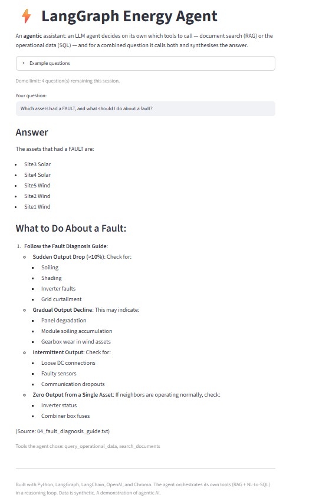

## Step 6 — Docker, CI and Azure deployment preparation (2026-10-11)

This version keeps the existing Streamlit UI and FastAPI API, and adds a **Dockerfile**, Docker Compose, GitHub Actions CI (offline tests and image build only), and a documented optional Azure Container Apps route. **Docker and Azure have not yet been run in this build environment.** See `STEP6_CHANGELOG.md` and `docs/azure-container-apps.md`.

**Windows with Docker Desktop (run from the inner `langgraph-energy-agent` folder):**

1. Copy your PRIVATE `.env` from the verified Step 5 version, with rotated `ENERGY_AGENT_API_KEY`, into this new project folder. Never upload or commit it. This container does **not** use your copied Windows `chroma_db`; it creates a fresh named Docker volume.
2. `docker compose version` — confirm Docker Desktop + Compose are installed and running.
3. `docker compose build` — build the image without supplying secrets at build time.
4. `docker compose run --rm ingest` — **once**, to embed the six synthetic documents into the named Chroma volume. This uses your OpenAI API credentials and may cost a small amount.
5. `docker compose up -d api` — run the API on `127.0.0.1:8000` only.
6. Open `http://127.0.0.1:8000/docs`, test `GET /health` (200) and an authenticated `POST /ask` with your private key (200). An invalid key should return 401. Never share a Swagger screenshot containing the key.
7. `docker compose logs --tail=50 api` shows server logs; `docker compose down` stops containers **without deleting the indexed named volumes**. Do not run `docker compose down -v` unless you intentionally want to destroy the local Chroma index and logs.

**Offline Python CI-equivalent check:**

```cmd
python -m pip install -r requirements-dev.txt
python -m pytest -q
python evaluation/run_eval.py --dry-run
python scripts/check_tracked_files.py
```

**GitHub:** push the clean project into your own repository (never `.env`/`chroma_db`/`traces`). `.github/workflows/ci.yml` automatically runs on pushes and pull requests and checks the Docker image build. Do not claim CI ran successfully until the GitHub Actions checks are green. No Azure deploy is triggered.

**Azure:** only a **documented optional staging procedure**, not a deployed live endpoint. See `docs/azure-container-apps.md` for secrets, startup index initialization, storage caveats, exposure risks and costs.

---

# ⚡ LangGraph Energy Agent (Agentic AI)

**🔗 Live demo:** https://anurilanggraph-energy-agent.streamlit.app/

## Demo



An Agentic AI assistant for energy operations, built with **LangGraph**. Unlike a hand-coded
router, here an LLM agent decides on its own which tools to call — and for a combined question it
calls multiple tools in sequence and synthesises the answer.

This is the agentic counterpart to a hand-built RAG + orchestrator project: same domain, but the
LLM orchestrates its own tool use in a reasoning loop (the ReAct pattern) rather than following
if/else routing I wrote.

## What it does
The agent has two tools and chooses between them per question:
- **search_documents** — RAG over energy-operations documents (procedures, thresholds, guidance), grounded and cited.
- **query_operational_data** — natural-language-to-SQL over an operational data table (counts, statuses, anomalies; read-only queries).

For a combined question ("which assets faulted, and what should I do about it?"), the agent
decomposes it itself, calls both tools, and merges the results — no hand-written routing.

## Architecture (LangGraph)
- **State** — the message history that flows through the graph.
- **Agent node** — the LLM decides: call a tool, or answer.
- **Tool node** — runs the chosen tool; the result returns to the agent.
- **Conditional edge** — loops agent → tool → agent until the agent produces a final answer.

## Tech stack
- **Python**, **LangGraph** + **LangChain**, **OpenAI** (gpt-4o-mini + text-embedding-3-small), **Chroma** (vector store)

## Files
- `api.py` — authenticated FastAPI HTTP adapter (`POST /ask`, `GET /health`)
- `tests/test_api.py` — mock-only HTTP tests (no OpenAI charges)
- `sql_security.py` — SQLite read-only enforcement, SQL authorizer and execution limits
- `prompt_boundaries.py` — separate trusted model instructions from untrusted inputs
- `tests/test_sql_security.py` and `tests/test_prompt_injection.py` — offline guardrail tests
- `tests/test_agent_orchestration.py` — mock-only agent tool routing and trace tests
- `tests/test_rag_regression.py` — mock-only RAG retrieval and empty-index tests
- `tests/test_evaluation_regression.py` — offline benchmark scoring/format checks
- `hello_graph.py` — a minimal graph demonstrating state / node / edge
- `rag_tool.py` — the documents tool (RAG)
- `sql_tool.py` — the data tool (NL-to-SQL)
- `agent.py` — the two-tool agent and routing policy
- `observability.py` — sanitized JSONL tracing, prompt versions, provider-reported tokens and summary CLI
- `evaluation/` — deterministic regression benchmark and evaluator
- `docs/agent_evaluation_observability_report.md` — short evaluation and observability report

## Running locally
```bash
python -m venv venv
venv\Scripts\activate          # Windows
pip install -r requirements.txt
# add your key to a .env file:  OPENAI_API_KEY=sk-...
python ingest.py               # build the document index (once)
python agent.py                # run the agent on sample questions
```

## Step 2: HTTP API (FastAPI)

This adds an **optional** HTTP interface over the **same** `run_agent()` used by
Streamlit. `app.py` and the tool-routing logic in `agent.py` are unchanged.

Install and prepare the project from the repository root:

```bash
python -m pip install -r requirements.txt
# Copy .env.example to .env and fill in your own values; do not share .env.
# Generate an independent app API secret:
python -c "import secrets; print(secrets.token_urlsafe(32))"
# Put this output in ENERGY_AGENT_API_KEY (not OPENAI_API_KEY).
python ingest.py  # needed the first time to create the API's document index
uvicorn api:app --host 127.0.0.1 --port 8000
```

In a **second** terminal, call the API. Replace YOUR_APP_API_SECRET with the
value of `ENERGY_AGENT_API_KEY` from your local `.env`:

```bash
curl -X POST http://127.0.0.1:8000/ask \
  -H "Content-Type: application/json" \
  -H "X-API-Key: YOUR_APP_API_SECRET" \
  -d '{"question":"How many assets had a FAULT status?"}'
```

For Windows PowerShell, use `curl.exe` in place of `curl` and quote JSON
according to your shell, or use:

```powershell
$headers = @{ 'X-API-Key' = 'YOUR_APP_API_SECRET' }
$body = @{ question = 'How many assets had a FAULT status?' } | ConvertTo-Json
Invoke-RestMethod -Method Post -Uri http://127.0.0.1:8000/ask -Headers $headers -ContentType 'application/json' -Body $body
```

Typical response (illustrative, not a live test result):

```json
{"answer":"...", "tools_used":["query_operational_data"], "trace_id":"...", "latency_ms":1234.5}
```

`GET /health` returns `{"status":"ok"}` (only process liveness, not an LLM
connectivity or data-readiness check). The interactive API schema is at `/docs`.

**Security and limits:** `POST /ask` requires an `X-API-Key` matching
`ENERGY_AGENT_API_KEY`; if the server key is absent, requests fail closed. User
questions must contain 1–500 non-whitespace characters (whitespace at the edges
is stripped). Unknown JSON fields are rejected. The response excludes agent
message history and detailed tool arguments. Upstream exceptions are not sent
back to callers. Keep the API key server-side, use HTTPS behind a proxy if
exposing the service, and never commit `.env`. The API **does not inherit**
Streamlit's five-question session cap and has **no persistent request-rate
limiter yet**; do not expose it publicly without additional usage controls.
Step 3 adds SQL hardening; request-rate limiting and production deployment controls remain future work.

You can still run the original Streamlit app independently:

```bash
streamlit run app.py
```

Run the HTTP tests without spending OpenAI tokens:

```bash
python -m pip install -r requirements-dev.txt
python -m pytest tests/test_api.py -q
```

These mocked tests do not prove live agent execution. After setting up the
OpenAI key and ingested index, run a local authenticated request to validate
end-to-end operation. Step 2 has not changed the separate NL-to-SQL security
implementation or the historical 26-case evaluation.


## Step 3: SQL guardrails and prompt-injection regression tests

**Scope:** security hardening on top of the Step 2 API, with no change to the
HTTP paths or the Streamlit UI. This is a demonstration, not a security audit.

- The SQL tool still loads the **synthetic** `data/operational_data.csv` into
  in-memory SQLite, but it locks the connection with `PRAGMA query_only=ON`
  **after** data import and **before** executing generated SQL.
- `sql_security.py` checks for a single SELECT without comments or stacked
  statements, and enforces a SQLite authorizer restricted to the `operations`
  table and an allowlist of SQL functions. Reads of SQLite metadata tables,
  attachment, extensions, DDL and writes are denied.
- To reduce accidental runaway queries, SQL text is limited to 2,000 chars;
  successful results are limited to 200 rows, and SQLite work is bounded by a
  virtual-machine instruction budget. Queries exceeding limits are **blocked**,
  not silently truncated into potentially misleading answers.
- SQL-generation instructions are given as a system message separate from the
  question. Retrieved document excerpts remain in lower-trust model input and
  are explicitly described as *untrusted data*, not instructions. The agent
  also receives a trust-boundary reminder. **Prompt instructions alone do not
  guarantee immunity to injection**; SQLite policy enforces the SQL boundary.
- SQL policy failures return a safe message and are logged as `sql_blocked`
  with a reason in local traces. Internal SQLite errors are not reflected to
  API consumers through the SQL tool.

**Offline verification (does not require OpenAI credits):**

```powershell
python -m pip install -r requirements-dev.txt
python -m pytest -q
python evaluation/run_eval.py --dry-run
```

The Step 3 build passed **49 automated offline tests** and **validated the
26 existing evaluation definitions** in dry-run mode. The tests include 13
existing mocked HTTP checks and new SQL-policy / injection-boundary checks.
They use the actual SQLite + CSV data for the security assertions and a mocked
LLM for malicious SQL generation. They **do not** demonstrate live rejection
of every prompt-injection attempt or rerun the 26-case live LLM evaluation.

### Windows: verify locally before Step 4

1. Extract the Step 3 ZIP into **a new folder** and enter its inner
   `langgraph-energy-agent` directory. Keep your functioning Step 2 directory
   as a backup.
2. Copy your **private** `.env` from the Step 2 inner folder into the Step 3
   inner folder (never upload or commit it). Make sure you have rotated the
   `ENERGY_AGENT_API_KEY` shown in your earlier screenshot. The ZIP only ships
   `.env.example`.
3. Copy the existing `chroma_db` directory from your Step 2 inner folder
   to Step 3, or run `python ingest.py` to rebuild it (rebuilt embeddings may
   incur API charges).
4. In the Step 3 inner directory, run the offline tests above, then launch
   the API via `python -m uvicorn api:app --host 127.0.0.1 --port 8000` and
   Streamlit via `python -m streamlit run app.py` (in separate terminals).
5. In the UI, try a **normal SQL query** such as "How many assets had a FAULT
   status?" and a normal combined question. Confirm that answers and source
   references remain sensible. Do not include credentials in screenshots.

The existing Streamlit five-question session limit remains unchanged. FastAPI
still does **not** have persistent throttling, so run it locally only until
rate limits, deployment security and usage protections are added.

## Step 4: automated regression coverage (11 October 2026)

Step 4 extends the Step 3 test suite **without changing the Streamlit UI or
LangGraph graph topology**. Both interfaces continue to use the same agent.

- **FastAPI contract:** request type/format errors, unknown fields, malformed
  JSON, missing/wrong API keys, sanitised upstream failures, and public response
  fields. A malformed agent response is now handled as `502` rather than
  propagating an uncaught response-validation error.
- **Agent orchestration:** mock-only tests verify registration of the two
  original tools, recorded tool usage and calls (SQL, RAG, both, neither), trace
  ID lifecycle, and error cleanup. Tests do **not** force or prove real LLM
  choices; that requires the live 26-case evaluation.
- **RAG adapter:** fake embeddings, vector store, and response model verify
  retrieval inputs, source names, lower-trust prompts, and missing-result
  behaviour. Empty document retrievals now return an explicit not-found answer
  rather than asking the model to improvise from no context.
- **Evaluation:** added tests for deterministic grading (routing, expected
  facts, source evidence, refusal, anti-fabrication, optional groups, and report
  output). The evaluation dry run now validates category, tool names, group
  definitions, source lists, refusal regexes, thresholds and unique IDs
  **before** any live model invocation.
- **SQL security:** retains all Step 3 tests and constraints unchanged.

**Run on Windows (Command Prompt, from the new Step 4 project's inner
`langgraph-energy-agent` folder):**

```cmd
python -m pip install -r requirements-dev.txt
python -m pytest -q
python evaluation/run_eval.py --dry-run
```

The offline suite should report **109 passed**. These tests make **zero live
OpenAI requests**. `--dry-run` validates **26 case definitions**; it is *not*
a claim that 26 live agent questions passed. For optional coverage output:

```cmd
python -m pytest --cov=api --cov=sql_security --cov=evaluation.run_eval --cov-report=term-missing -q
```

**Local smoke check:** Move your private, rotated `.env` and your existing
`chroma_db` folder from the Step 3 project into the Step 4 inner folder. Do
not copy Git history or publish `.env`. Run `python -m streamlit run app.py`
and optionally `python -m uvicorn api:app --host 127.0.0.1 --port 8000` in a
second terminal, then test the normal `/health` and authorised `/ask` paths.
One authorised `/ask` request may incur OpenAI API charges. No need to redo
all 26 live cases until the final verification stage (Step 7).

**Limits:** Mocks and offline tests cannot establish end-to-end model
reliability, a complete prompt-injection defence, or production readiness.
Persistent API rate limiting and cloud deployment remain for later steps.

## Data
All data is synthetic and created for demonstration — no proprietary content.

## Notes
Built independently to demonstrate agentic AI fundamentals — tools, the ReAct loop, and
LLM-driven tool orchestration — using LangGraph.

## Evaluation & traceability

The repo includes a 26-case deterministic regression benchmark in `evaluation/` covering:

- document/RAG questions,
- SQL/structured-data questions,
- combined multi-tool workflows,
- and unsupported-question refusal.

The evaluator checks tool routing, required facts, source grounding, refusal behaviour,
anti-fabrication guards, end-to-end pass/fail, and latency. Runtime JSONL traces capture
observable events such as requested tools, retrieved source files, generated SQL, result
previews, final answers, failures, and optional user feedback. Hidden chain-of-thought is
not logged.

### Regression result

The first valid benchmark run scored **23/26**. Failure analysis found:

- one genuine agent-routing defect,
- one refusal-detector false negative,
- and one literal asset-name matching false negative.

After adding a general routing/refusal policy to the agent and correcting the two evaluator
measurement issues, the same 26 benchmark cases were rerun and scored 26/26.

The anti-fabrication pattern guards were not weakened between the baseline and final run.

> **Important:** 26/26 is a regression result on a small controlled synthetic benchmark. It is
> not a claim of production-wide 100% reliability.

```bash
python evaluation/run_eval.py --dry-run   # validate benchmark only
python evaluation/run_eval.py             # full run; requires OPENAI_API_KEY
```

See `evaluation/README.md` for benchmark details and
`docs/agent_evaluation_observability_report.md` for the failure analysis, fixes, final metrics,
and limitations.


## Step 5: LLMOps / observability (11 October 2026)

This upgrade builds on Steps 2–4 and **does not** replace the LangGraph agent,
Streamlit app, FastAPI interface or security controls.

- `run_start`, `llm_call`, `run_complete`, `run_error` and tool events share a
  request trace ID where LangGraph propagates execution context.
- Trusted prompt instructions are identified by a **content-derived SHA-256
  version**; changes to instructions produce new version IDs automatically.
  Router, RAG answer, SQL generation and SQL answer prompts are tracked.
- Model calls log provider-reported input, output and total tokens when present.
  Embedding calls report input usage. Missing usage is explicitly **unknown**,
  not inferred and not zero. Partial run totals are labelled incomplete.
- Router call durations are unknown (not reported as zero); full run latency is
  measured. RAG, embedding and SQL provider-call latency is measured locally.
- JSONL logs omit raw questions, prompts, SQL, row previews, tool arguments,
  model answers and exception text. Source filenames, trace IDs and metrics
  remain; treat logs as internal artifacts and do not publish them.
- `python observability.py` gives a local run summary (successful runs, errors,
  median/p95 latency, known token totals and fully measured run count).

### Windows local verification

In the **inner** `langgraph-energy-agent` folder of the extracted Step 5 ZIP:

```cmd
python -m pip install -r requirements-dev.txt
python -m pytest -q
python evaluation/run_eval.py --dry-run
python -m streamlit run app.py
```

After one successful real agent request, stop Streamlit with `Ctrl+C` and run:

```cmd
python observability.py
```

A JSON object with `completed` >= 1 verifies that run-level telemetry was
persisted locally. Optionally review individual metadata events in
`traces/agent_traces.jsonl`. **Never share your `.env` or API keys.**

Only copy your **private** `.env` and `chroma_db` from the verified Step 4
project into Step 5. Do **not** copy old `traces/`, which may contain the older
verbose prompt/SQL/answer logs. Keep each ZIP extracted into its own folder.

`python -m pytest -q` uses mocked OpenAI calls and spends no tokens;
`python evaluation/run_eval.py --dry-run` validates 26 evaluation definitions,
not live correctness. A real Streamlit/API question uses OpenAI API credit.
This is local, demo-scale observability — not a cloud monitoring stack,
production tracing infrastructure or a proof of prompt-injection immunity.
